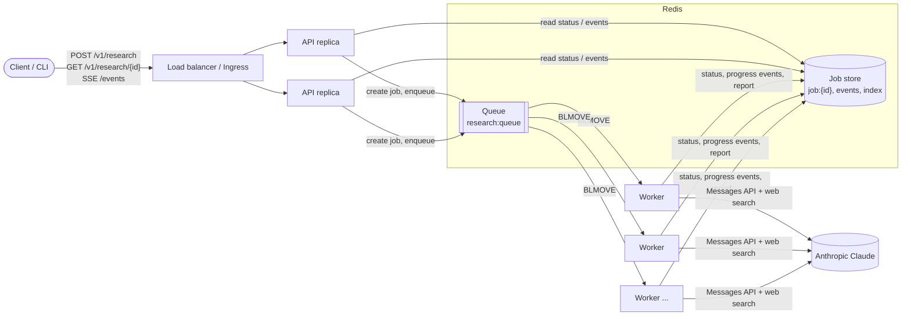
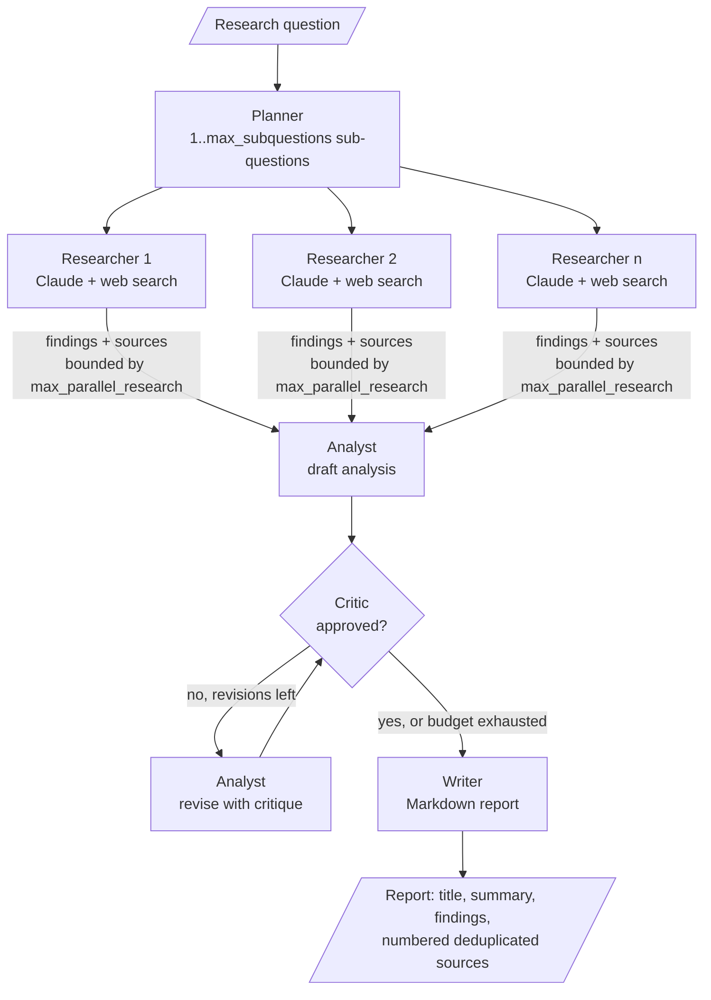

# Multi-Agent Research Assistant

[](https://github.com/imranmali/multi-agent-research-assistant/actions/workflows/ci.yml)
[](https://github.com/imranmali/multi-agent-research-assistant/actions/workflows/release.yml)
[](LICENSE)
[](pyproject.toml)

A production-ready, horizontally scalable research service. Give it an open question and a team
of specialised agents plans the research, searches the web in parallel, reconciles the
evidence, critiques and revises its own analysis, and writes a cited Markdown report.

- **LLM:** Anthropic Claude (`claude-opus-5-5`) through the official `anthropic` Python SDK,
  using Claude's server-side **web search** tool for evidence.
- **Offline mode:** a deterministic `mock` provider needs no API key and no network. Tests, CI
  and demos use it.
- **Service:** a FastAPI HTTP API, a Redis-backed job queue and separately scaled worker
  processes. It ships as one container image, with Docker Compose and Kubernetes manifests.

---

## Contents

- [Architecture](#architecture)
- [Features](#features)
- [Quickstart](#quickstart)
- [Configuration](#configuration)
- [API reference](#api-reference)
- [Scaling and production notes](#scaling-and-production-notes)
- [Observability](#observability)
- [Development workflow](#development-workflow)
- [Testing](#testing)
- [CI/CD](#cicd)
- [Project layout](#project-layout)
- [License](#license)

---

## Architecture

### Service topology

The API is stateless. All job state lives in Redis, and long-running research runs in worker
processes, so you scale API replicas and workers independently.



With `JOB_BACKEND=memory` (the default for local development), the API process runs jobs itself
with an in-process runner. No Redis or workers are needed, but it supports a single replica only.

### Agent pipeline

Control flow is plain, deterministic Python code. The model writes the content but does not
choose the next step.



Each stage emits ordered progress events (`stage_started`, `stage_completed`, `stage_failed`,
`job_*`). The API stores them and streams them to clients over Server-Sent Events.

## Features

- **Five cooperating agents:** Planner, Researcher (parallel), Analyst, Critic (a bounded
  revision loop) and Writer.
- **Cited reports:** a Markdown report with an executive summary, findings and a numbered,
  deduplicated source list.
- **Resilient by design:**
  - A tolerant JSON parser with fallbacks handles Planner and Critic output.
  - If one sub-question fails, the run continues and the report notes the gap.
  - Model refusals surface as stage errors, and server-side refusal fallbacks are enabled.
- **Asynchronous jobs:** submitting returns `202 Accepted` with a job id. You can poll, stream
  progress (SSE), list or cancel jobs.
- **Horizontal scaling:** stateless API replicas plus `research-worker` processes. Each worker
  has bounded concurrency and shuts down gracefully on SIGTERM.
- **Operations:**
  - `/healthz`, `/readyz` and Prometheus `/metrics`.
  - JSON structured logs, with an `X-Request-ID` on every response.
  - Optional API-key authentication.
- **Delivery:**
  - A hardened, multi-arch container image (non-root, with a health check).
  - Docker Compose and Kubernetes manifests (HPA, PDB, probes).
  - GitHub Actions CI/CD, CodeQL and Dependabot.

## Quickstart

### 1. Local install with the mock provider (no API key)

Requires Python 3.11+.

```bash
git clone https://github.com/imranmali/multi-agent-research-assistant.git
cd multi-agent-research-assistant
python -m venv .venv && . .venv/bin/activate
pip install -e ".[dev]"          # or: make install
cp .env.example .env             # optional; defaults use the mock provider
```

### 2. Run research from the CLI

```bash
research-assistant run "What is the state of solid-state batteries?" --provider mock
```

### 3. Run the API

```bash
research-assistant serve         # http://localhost:8000 (in-memory job backend)
```

Submit a job (the response is `202 Accepted` with `{"id": "...", "status": "queued"}`):

```bash
curl -s -X POST http://localhost:8000/v1/research \
  -H 'Content-Type: application/json' \
  -d '{"question": "What is the state of solid-state batteries?",
       "options": {"max_subquestions": 3, "max_revisions": 1}}'
```

Stream progress events until the job finishes (Server-Sent Events):

```bash
curl -N http://localhost:8000/v1/research/<id>/events
```

Fetch the result, list jobs, or cancel a job:

```bash
curl -s http://localhost:8000/v1/research/<id>              # status + report.markdown + report.sources
curl -s 'http://localhost:8000/v1/research?limit=20&offset=0'
curl -s -X DELETE http://localhost:8000/v1/research/<id>    # 202, or 409 if already finished
```

When `API_KEYS` is set, add `-H 'X-API-Key: <key>'` to every `/v1` request.

### 4. Full stack with Docker Compose (Redis + API + 2 workers)

```bash
docker compose up --build        # or: make compose-up
curl -s http://localhost:8000/readyz
docker compose up --scale worker=4 -d   # more research throughput
docker compose down              # or: make compose-down
```

### 5. Use real Claude research

```bash
export LLM_PROVIDER=anthropic
export ANTHROPIC_API_KEY=sk-ant-...
research-assistant run "How do grid-scale batteries affect electricity prices?"
# or with Docker Compose (the key is passed through from your shell, never baked into the image):
LLM_PROVIDER=anthropic ANTHROPIC_API_KEY=sk-ant-... docker compose up --build
```

Real runs make several Claude calls per question: one per agent step, plus web searches for
each sub-question. See [Scaling and production notes](#scaling-and-production-notes) for the
cost controls.

### 6. Container image

```bash
docker run --rm -p 8000:8000 -e LLM_PROVIDER=mock ghcr.io/imranmali/multi-agent-research-assistant:latest
# worker role (needs Redis):
docker run --rm -e JOB_BACKEND=redis -e REDIS_URL=redis://redis:6379/0 \
  ghcr.io/imranmali/multi-agent-research-assistant:latest research-worker
```

## Configuration

Every setting is an environment variable: the upper-case name of a field in
[`src/research_assistant/config.py`](src/research_assistant/config.py). Settings are also read
from a local `.env` file. [`.env.example`](.env.example) lists them all with their defaults.

| Variable | Default | Description |
|---|---|---|
| **Service** | | |
| `APP_NAME` | `multi-agent-research-assistant` | Service name used in logs and metadata. |
| `ENVIRONMENT` | `development` | `development`, `staging`, `production` or `test`. |
| `LOG_LEVEL` | `INFO` | Root log level (`DEBUG`, `INFO`, `WARNING`, ...). |
| `LOG_JSON` | `true` | JSON log lines when true; human-readable console output when false. |
| **LLM** | | |
| `LLM_PROVIDER` | `mock` | `mock` (offline, deterministic) or `anthropic` (Claude). |
| `ANTHROPIC_API_KEY` | (unset) | Claude API key. Required when `LLM_PROVIDER=anthropic`. Keep it in a secret store. |
| `ANTHROPIC_MODEL` | `claude-opus-5-5` | Claude model id. |
| `ANTHROPIC_EFFORT` | `medium` | Reasoning effort: `low`, `medium`, `high`, `xhigh` or `max`. Higher means more thorough, with more tokens and cost. |
| `ANTHROPIC_MAX_TOKENS` | `16000` | Max output tokens per call (1024–128000). |
| `ANTHROPIC_TIMEOUT_SECONDS` | `600` | Per-request timeout for Claude calls. |
| `ANTHROPIC_MAX_RETRIES` | `3` | SDK retries on 429/5xx (0–10). |
| `ANTHROPIC_ENABLE_FALLBACKS` | `true` | Enable server-side refusal fallbacks. |
| `MAX_SEARCH_USES` | `5` | Max web searches per research sub-question (1–20). |
| **Research defaults** (overridable per request through `options`) | | |
| `MAX_SUBQUESTIONS` | `4` | Max sub-questions the Planner may produce (1–10). |
| `MAX_PARALLEL_RESEARCH` | `4` | Max sub-questions researched concurrently (1–16). |
| `MAX_REVISIONS` | `1` | Max Critic-driven revision rounds (0–5). |
| **Jobs** | | |
| `JOB_BACKEND` | `memory` | `memory`: jobs run in the API process (single replica, dev). `redis`: shared store and queue, executed by workers. |
| `REDIS_URL` | `redis://localhost:6379/0` | Redis connection URL (`rediss://` for TLS). |
| `JOB_TTL_SECONDS` | `604800` | Retention of jobs and their events (default 7 days, min 60). |
| `WORKER_CONCURRENCY` | `2` | Jobs one worker process runs at the same time (1–64). |
| `WORKER_SHUTDOWN_GRACE_SECONDS` | `30` | How long a worker waits for running jobs after SIGTERM. |
| `WORKER_HEARTBEAT_SECONDS` | `10` | Worker heartbeat interval; jobs of a worker silent for 3 intervals are re-queued. |
| `QUEUE_NAME` | `research:queue` | Redis list used as the job queue. |
| `WORKER_METRICS_PORT` | `9100` | Port of the worker's Prometheus metrics endpoint. |
| **API** | | |
| `API_KEYS` | (empty, auth disabled) | Comma-separated keys accepted in the `X-API-Key` header on `/v1` routes. |
| `CORS_ORIGINS` | (empty, CORS disabled) | Comma-separated allowed browser origins. |
| `MAX_LIST_LIMIT` | `100` | Max page size for `GET /v1/research` (1–1000). |
| `SSE_POLL_INTERVAL_SECONDS` | `0.5` | How often the SSE endpoint polls for new events. |
| **Container runtime** (not application settings) | | |
| `FORWARDED_ALLOW_IPS` | `127.0.0.1` | Proxy IPs uvicorn trusts for `X-Forwarded-*` (the image runs with `--proxy-headers`). |
| `HEALTHCHECK_URL` | `http://127.0.0.1:8000/healthz` | URL the image's `HEALTHCHECK` probes. Set it to the worker metrics URL for workers. |

## API reference

All `/v1` routes require `X-API-Key` when `API_KEYS` is set. Operational endpoints are always
public. Every response carries an `X-Request-ID` header: the client's value if one was sent,
otherwise a generated one.

| Method | Path | Description | Responses |
|---|---|---|---|
| `POST` | `/v1/research` | Submit a question. Body: `{"question": str (3–2000 chars), "options": {"max_subquestions", "max_parallel_research", "max_revisions"}}` (options are optional). | `202` `{id, status: "queued"}`, `401`, `422` |
| `GET` | `/v1/research/{id}` | Job status, timestamps (`created_at`, `started_at`, `finished_at`), `error`, and the `report` (`markdown`, `sources`, ...) once completed. | `200`, `401`, `404` |
| `GET` | `/v1/research?limit=&offset=` | Recent jobs, newest first. `limit` is capped at `MAX_LIST_LIMIT`. | `200`, `401` |
| `DELETE` | `/v1/research/{id}` | Cancel a queued or running job. A running job stops cooperatively at the next stage boundary. | `202`, `401`, `404`, `409` (already finished) |
| `GET` | `/v1/research/{id}/events` | Server-Sent Events. Replays past progress events, then follows new ones until a terminal event. | `200 text/event-stream`, `401`, `404` |
| `GET` | `/healthz` | Liveness: the process is up. | `200` |
| `GET` | `/readyz` | Readiness: the job store (Redis) is reachable. | `200`, `503` |
| `GET` | `/metrics` | Prometheus text exposition. | `200` |

Job lifecycle: `queued → running → completed | failed | cancelled`, or `queued → cancelled`.
Interactive OpenAPI docs are served by FastAPI at `/docs`.

## Scaling and production notes

- **Stateless API.** Run two or more API replicas behind a load balancer with
  `JOB_BACKEND=redis`. Any replica can serve any job, including SSE streams.
- **Scale workers for throughput.**
  - Total research capacity is `workers × WORKER_CONCURRENCY` concurrent jobs.
  - Workers are IO-bound (they wait on Claude), so prefer more concurrency per worker before
    adding CPU.
  - The Kubernetes HPA scales on CPU. Queue-length autoscaling (for example KEDA on the Redis
    list `QUEUE_NAME`) is a better signal and is the recommended next step.
- **Redis HA.**
  - Redis is the single source of truth for jobs. In production, use a managed or replicated
    Redis (ElastiCache, Memorystore, Azure Cache, or a Sentinel/Cluster operator) with
    persistence.
  - Use TLS (`rediss://`) and set `maxmemory-policy noeviction`. Jobs expire through
    `JOB_TTL_SECONDS`.
  - The bundled `deploy/k8s/redis.yaml` is a single-node StatefulSet for evaluation only.
- **Graceful shutdown.**
  - On SIGTERM a worker stops taking jobs and waits up to `WORKER_SHUTDOWN_GRACE_SECONDS`.
  - Keep the orchestrator's kill timeout above that value. The manifests use
    `terminationGracePeriodSeconds: 60` with a 45-second grace period, and Compose uses
    `stop_grace_period: 60s`.
- **Crash recovery.**
  - Workers heartbeat every `WORKER_HEARTBEAT_SECONDS`. If a worker dies (OOM kill, node
    loss), a surviving worker re-queues its in-flight jobs after three missed heartbeats and
    they run to completion elsewhere (at-least-once delivery).
  - Recoveries are logged (`worker_recovered_jobs`) and counted in
    `research_jobs_recovered_total`.
- **Timeouts.**
  - `ANTHROPIC_TIMEOUT_SECONDS` bounds each Claude call, and `ANTHROPIC_MAX_RETRIES` retries
    429/5xx with backoff.
  - SSE connections are long-lived, so raise idle and read timeouts on proxies and ingresses
    and disable response buffering. `deploy/k8s/ingress.yaml` shows the nginx annotations.
- **Cost controls.** Cost per question grows roughly with
  `max_subquestions × (1 + max_search_uses)` plus the analysis and revision rounds. Tune these
  limits:
  - `MAX_SUBQUESTIONS`, `MAX_SEARCH_USES` and `MAX_REVISIONS` set the amount of work.
  - `ANTHROPIC_EFFORT` sets how deeply Claude reasons. `low` or `medium` is usually enough for
    research summaries.
  - `ANTHROPIC_MAX_TOKENS` caps the output length.
  - Clients can lower the limits per request through `options`, but cannot exceed the
    validated maximums.
- **Refusals.**
  - With `ANTHROPIC_ENABLE_FALLBACKS=true`, Claude's server-side refusal fallback is tried
    first.
  - A remaining refusal fails only the affected stage or sub-question, and the error message
    names the refusal. The report notes the gap.
- **Security.**
  - Set `API_KEYS` (long, random, rotated) and terminate TLS at the ingress.
  - Keep `ANTHROPIC_API_KEY` in a Secret, never in a ConfigMap or image.
  - The image runs as uid 10001 with a read-only root filesystem in Kubernetes, and the
    namespace enforces the `restricted` Pod Security Standard.
- **Rollout and rollback.** Images are immutable (`sha-<commit>`, semver tags, and digests). To
  roll back, redeploy the previous tag. Redis data is disposable because of its TTL.

## Observability

- **Logs.**
  - Logs are structured JSON lines (`LOG_JSON=true`) written to stderr through structlog. The
    stdlib and uvicorn loggers use the same pipeline.
  - Each line carries `timestamp`, `level`, `logger`, `event`, and correlation fields such as
    `request_id` and `job_id`.
  - Set `LOG_JSON=false` for human-readable local output.
- **Request ids.** Send `X-Request-ID` to correlate a client call with server logs. The API
  echoes it, or generates one, on every response.
- **Metrics.**
  - The API serves Prometheus metrics at `:8000/metrics`, and each worker serves them at
    `:WORKER_METRICS_PORT/metrics`.
  - The available metrics are:
    - `http_requests_total{method,route,status}`
    - `http_request_duration_seconds{method,route}`
    - `research_jobs_submitted_total`
    - `research_jobs_total{status}`
    - `research_job_duration_seconds{status}`
    - `research_jobs_running`
    - `research_jobs_recovered_total`
  - Pods carry `prometheus.io/*` scrape annotations.
- **Health.**
  - Kubernetes probes use `/readyz` for readiness (it fails while Redis is unreachable) and
    `/healthz` for liveness.
  - The image's Docker `HEALTHCHECK` uses only the Python standard library.

## Development workflow

### Spec-driven changes with OpenSpec

Every behaviour change starts as an [OpenSpec](https://github.com/Fission-AI/OpenSpec) change
in `openspec/changes/<name>/`:

- `proposal.md` explains why and what, including what is out of scope.
- `design.md` records the decisions.
- `specs/**/spec.md` holds requirements with WHEN/THEN scenarios.
- `tasks.md` is a checklist in which each task states how it is verified.

```bash
npm install -g @fission-ai/openspec@1.14.3

# 1. Propose: create the change and its artifacts (or /opsx:propose in Claude Code)
openspec new change add-my-feature
openspec validate add-my-feature --strict

# 2. Apply: implement tasks.md and tick each box as its verification passes (/opsx:apply)
openspec status --change add-my-feature
openspec validate --all --strict        # also run in CI

# 3. Archive: once merged, fold the spec deltas into openspec/specs/ (/opsx:archive)
openspec archive add-my-feature
```

### Branching and commits

- `main` is protected. It only accepts pull requests with green CI and a review from
  [CODEOWNERS](.github/CODEOWNERS). Every commit on `main` is releasable.
- Use short-lived branches off `main`: `feat/<topic>`, `fix/<topic>`, `docs/<topic>` and
  `ci/<topic>` (plus `refactor/`, `test/` and `chore/` as needed).
- Write commit messages and PR titles as [Conventional Commits](https://www.conventionalcommits.org/),
  for example `feat(api): stream progress over SSE`, `fix(worker): ack after cancel` or
  `docs: add scaling notes`.
- Merge only when every check is green. Squash-merge keeps the history linear.
- Releases are tags `vX.Y.Z` on `main`. Move entries from *Unreleased* into the new version in
  [CHANGELOG.md](CHANGELOG.md).

See [CONTRIBUTING.md](CONTRIBUTING.md) for the full guide.

## Testing

Tests never need network access or API keys. They use the `mock` provider and `fakeredis`.

```bash
make lint          # ruff check src tests && ruff format --check src tests
make typecheck     # mypy (strict)
make test          # pytest
make cov           # pytest --cov=research_assistant --cov-report=xml --cov-fail-under=85
make openspec-validate
pytest tests/unit -q                 # a subset
pytest -m integration                # end-to-end tests only
```

## CI/CD

| Workflow | Trigger | What it does |
|---|---|---|
| [`ci.yml`](.github/workflows/ci.yml) | pull requests, pushes to `main`, manual | Ruff lint and format check, and mypy. Pytest on Python 3.11, 3.12 and 3.13, with an 85% coverage gate and a `coverage.xml` artifact on 3.12. `openspec validate --all --strict`. A Docker build (amd64, GHA cache) followed by a container smoke test: `/healthz` within 30s, then `POST /v1/research` must return 202. |
| [`release.yml`](.github/workflows/release.yml) | pushes to `main`, `v*.*.*` tags | Builds and pushes a multi-arch (amd64 and arm64) image to `ghcr.io/imranmali/multi-agent-research-assistant` with SBOM and provenance. It is tagged `sha-<commit>`, `latest` (on `main`), and `X.Y.Z` plus `X.Y` (on tags). Tags also create a GitHub Release with generated notes. An optional `deploy` job runs `kubectl apply -k deploy/k8s` in the `production` environment when the `KUBE_CONFIG` secret is configured. |
| [`codeql.yml`](.github/workflows/codeql.yml) | pull requests, pushes to `main`, weekly | CodeQL security analysis for Python. |
| [`dependabot.yml`](.github/dependabot.yml) | weekly | Grouped minor and patch updates for pip, Docker and GitHub Actions. |

Workflows default to `permissions: contents: read`. Only the publish job gets `packages: write`,
and only the release job gets `contents: write`. CI needs no secrets, so it also passes on forks.

**Deploying to Kubernetes**

```bash
kubectl create namespace research-assistant
kubectl -n research-assistant create secret generic research-assistant-secrets \
  --from-literal=ANTHROPIC_API_KEY=sk-ant-... --from-literal=API_KEYS=<long-random-key>
kubectl apply -k deploy/k8s
kubectl -n research-assistant port-forward svc/research-api 8000:80
```

In production, pin the image to a released tag or digest in `deploy/k8s/kustomization.yaml`
and point `REDIS_URL` at a managed Redis.

## Project layout

```text
.
├── src/research_assistant/
│   ├── agents/              # Planner, Researcher, Analyst, Critic, Writer, prompts, report rendering
│   ├── llm/                 # LLMClient protocol, Anthropic client, deterministic mock
│   ├── jobs/                # job store, queue, executor, in-process runner, research-worker
│   ├── api/                 # FastAPI app factory, routes, auth, SSE, health/metrics
│   ├── cli.py               # `research-assistant` CLI (run / serve / worker)
│   ├── config.py            # Settings (environment variables)
│   ├── logging.py           # structlog JSON logging with request/job ids
│   ├── metrics.py           # Prometheus collectors
│   └── models.py            # domain models (jobs, events, reports)
├── tests/                   # unit/, api/, integration/ (offline: mock provider + fakeredis)
├── openspec/                # specs and change proposals (spec-driven development)
├── deploy/k8s/              # Kustomize manifests: api, worker, redis, HPA, PDB, ingress
├── .github/                 # CI/CD workflows, Dependabot, templates, CODEOWNERS
├── Dockerfile               # multi-stage, non-root runtime image
├── docker-compose.yml       # redis + api + workers
├── Makefile                 # common developer commands
└── pyproject.toml           # package metadata, dependencies, tool configuration
```

## License

[MIT](LICENSE) © Imran Ali
